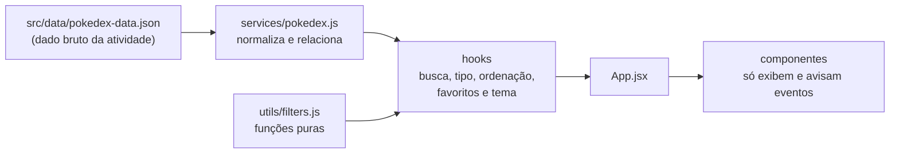
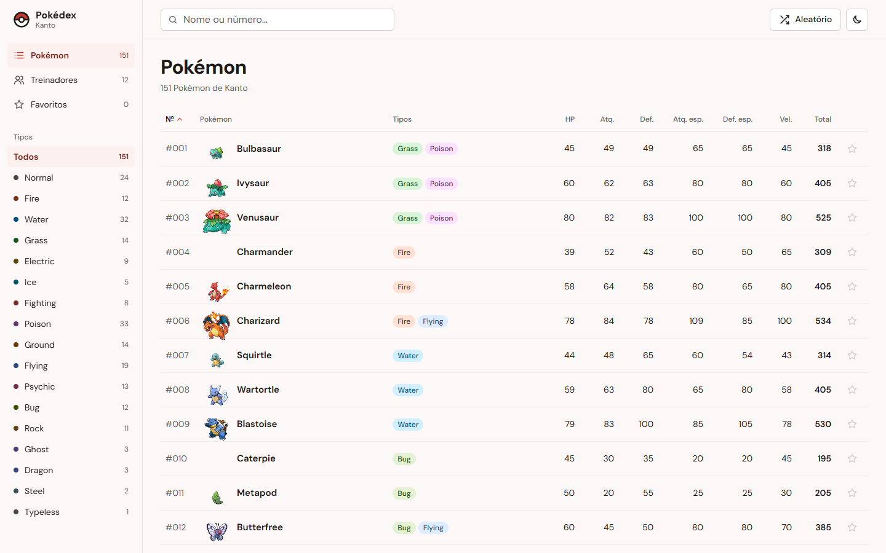
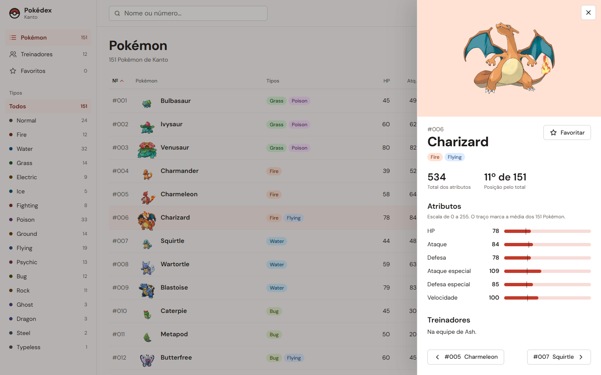
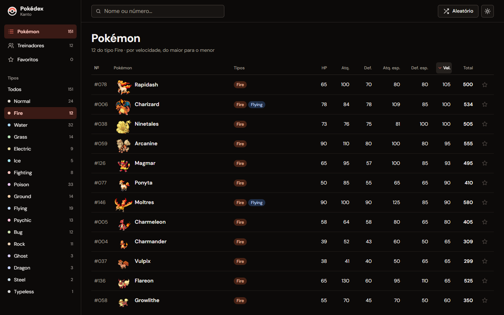

# Pokédex de Kanto

> [!NOTE]
> Pokédex interativa em **React + Vite** com os 151 Pokémon de Kanto: busca por nome ou número, filtro por tipo, ordenação por qualquer atributo, detalhe com ranking e a área dos treinadores. Todos os dados vêm do `pokedex-data.json` fornecido na atividade.

<table>
  <tr>
    <td width="800px">
      <div align="justify">
        Atividade 03 da disciplina <b>Desenvolvimento e Integração de Aplicações Web</b>, do Prof. Dr. João Paulo Aramuni, feita em dupla com <i>Pair Programming</i>. A Pokédex responde a uma pergunta: <b>como este Pokémon se compara aos outros?</b> Por isso a lista é uma tabela com os seis atributos lado a lado, ordenável por qualquer coluna, e o detalhe mostra a posição do Pokémon entre os 151 pelo total dos atributos.
      </div>
    </td>
    <td>
      <div>
        
      </div>
    </td>
  </tr>
</table>

---

## 🚧 Status do Projeto

    

---

## 📚 Índice

- [Sobre o Projeto](#-sobre-o-projeto)
- [Funcionalidades Principais](#-funcionalidades-principais)
- [Tecnologias Utilizadas](#-tecnologias-utilizadas)
- [Arquitetura](#-arquitetura)
- [Instalação e Execução](#-instalação-e-execução)
- [Dados e Imagens](#-dados-e-imagens)
- [Estrutura de Pastas](#-estrutura-de-pastas)
- [Demonstração](#-demonstração)
- [Testes](#-testes)
- [Documentações utilizadas](#-documentações-utilizadas)
- [Autores](#-autores)
- [Agradecimentos](#-agradecimentos)

---

## 📝 Sobre o Projeto

O objetivo da atividade é praticar React na prática: componentes, props, estado, eventos, renderização de listas, filtros e organização de um projeto front-end. A aplicação lê o `pokedex-data.json` da atividade e não depende de banco de dados nem de servidor próprio.

A identidade visual foi definida antes do código, no [`DESIGN.md`](DESIGN.md). O vermelho da Pokédex é a única cor forte e aparece só em marcas pequenas: o item ativo, as barras de atributo e a estrela de favorito. Cada um dos 17 tipos tem um fundo pálido e uma tinta escura do mesmo matiz, porque o tipo é dado, não enfeite.

---

## ✨ Funcionalidades Principais

**Pedidas na atividade**

- 🐾 **Lista dos 151 Pokémon** com número, nome, tipos, HP, Ataque, Defesa, Ataque especial, Defesa especial e Velocidade.
- 🔎 **Busca a cada tecla** por nome (`bulba`) ou número (`25`, `#25` ou `025`).
- 🧬 **Filtro por tipo**, com os tipos e as contagens tirados do JSON.
- 📄 **Detalhe do Pokémon** em painel lateral, com arte oficial, barras dos seis atributos e a média dos 151 marcada em cada barra.
- 🧑‍🚀 **Treinadores**: nome, insígnias e equipe. Clicar num Pokémon da equipe abre o detalhe dele.
- ⚠️ **Lista vazia tratada**: a tela diz o que foi buscado e oferece "Limpar filtros".
- 📱 **Layout responsivo** com composição própria no computador, no tablet e no celular.

**Desafios opcionais feitos**

- 📊 **Ordenação** por número, nome, total ou qualquer atributo. No computador, basta clicar no cabeçalho da coluna; no celular, há um seletor "Ordenar por".
- ⭐ **Favoritos**, salvos no navegador, com seção própria.
- 🎲 **Pokémon aleatório**, sorteado entre os que estão na lista atual.
- 🌙 **Tema escuro**, que segue o sistema e pode ser trocado pelo botão do topo.
- 🌐 **API externa**: imagens da PokéAPI. Se elas não carregarem, aparecem as iniciais, e a Pokédex continua funcionando só com o JSON.

**Extras**

- 🏅 **Posição pelo total** ("534 · 11º de 151"), com empates dividindo a mesma posição.
- 🔗 **Relação treinador e Pokémon** também no detalhe ("Na equipe de Ash").
- ⌨️ **Teclado**: no detalhe, `←` e `→` passam para o anterior e o próximo da lista, e `Esc` fecha, devolvendo o foco à linha de onde o detalhe saiu.

---

## 🛠 Tecnologias Utilizadas

### 💻 Front-end

- **Biblioteca:** React 19, com componentes funcionais e hooks
- **Linguagem:** JavaScript (ES2022+)
- **Build Tool:** Vite 8
- **Estilização:** CSS puro, um arquivo por componente em `src/css`, com variáveis de tema em `src/index.css`
- **Gerenciamento de estado:** `useState`, `useMemo` e hooks próprios (`usePokedexFilters`, `useFavorites` e `useTheme`)
- **Fonte:** DM Sans, empacotada pelo `@fontsource-variable/dm-sans`, sem CDN
- **Qualidade:** Vitest para os testes e oxlint (padrão do template do Vite) para o lint

Não há back-end nem banco de dados, porque a atividade fornece os dados em JSON.

---

## 🏗 Arquitetura

Os dados passam por três camadas, e cada uma tem uma responsabilidade só:



- **`services/pokedex.js`** lê o JSON uma vez e entrega os dados prontos para a tela: os tipos como lista de nomes, o total e a posição de cada Pokémon, os treinadores que têm cada um, as equipes dos treinadores resolvidas pelos `pokemonIds`, a contagem por tipo e a média de cada atributo. Nenhum componente lê o JSON direto.
- **`utils/filters.js`** guarda a busca, o filtro e a ordenação como funções puras: recebem uma lista e devolvem outra, sem alterar a original. Por isso são fáceis de testar.
- **Hooks** guardam só o estado escolhido pela pessoa (texto da busca, tipo e ordenação). A lista visível é **estado derivado**, calculado com `useMemo`, e nunca é guardada à parte.
- **Componentes** recebem dados por props e avisam eventos por callbacks. O `PokemonCard` usa `memo`, para que digitar na busca não redesenhe as 151 linhas.

**Decisões e limitações**

- **Sem roteador:** a seção ativa é um estado do `App`. A atividade não pede uma URL por seção, e uma dependência a menos mantém o projeto simples.
- **`PokemonCard` é uma linha de tabela**, não um card em grade. Comparar números é mais fácil com as colunas alinhadas, e a tabela mantém a semântica para leitores de tela. No celular, a mesma linha vira um item de duas linhas só com CSS.
- **Detalhe com `<dialog>` nativo:** o navegador já prende o foco, fecha com `Esc` e deixa o fundo inerte, sem biblioteca de modal.
- **Peculiaridades do JSON:** o Mew vem com `types: []` e aparece como `Typeless`, que é o tipo de id 0 do próprio arquivo. Koga tem três Venonat e Lance tem dois Dragonite, e a equipe é mostrada como está no arquivo.

---

## 🔧 Instalação e Execução

### Pré-requisitos

- **Node.js** 20.19 ou superior (exigência do Vite 8)
- **npm**, que vem com o Node

Não há variáveis de ambiente: o projeto não usa chave nem serviço com login.

### 📦 Instalação de Dependências

```bash
npm install
```

### ▶️ Como Executar a Aplicação

```bash
npm run dev
```

Abra **http://127.0.0.1:5173** no navegador.

> [!TIP]
> O servidor fica fixo em `127.0.0.1:5173` (`vite.config.js`). No Windows, `localhost` às vezes faz o Vite escutar só em IPv6 ou trocar de porta sem avisar.

### Outros comandos

| Comando | O que faz |
| :--- | :--- |
| `npm test` | Roda os testes uma vez |
| `npm run test:watch` | Roda os testes a cada alteração |
| `npm run lint` | Confere o código com o oxlint |
| `npm run build` | Gera a versão de produção em `dist/` |
| `npm run preview` | Serve a pasta `dist/` para conferir o build |

---

## 🗂 Dados e Imagens

- **Dados:** `src/data/pokedex-data.json`, o arquivo da atividade sem edição: 151 Pokémon, 18 tipos e 12 treinadores.
- **Imagens:** [repositório de sprites da PokéAPI](https://github.com/PokeAPI/sprites), carregadas pelo endereço do arquivo:
  - lista: `https://raw.githubusercontent.com/PokeAPI/sprites/master/sprites/pokemon/{id}.png`
  - detalhe: `https://raw.githubusercontent.com/PokeAPI/sprites/master/sprites/pokemon/other/official-artwork/{id}.png`
- Se a imagem falhar (sem internet, por exemplo), o Pokémon aparece com as iniciais no tom do tipo.

> [!IMPORTANT]
> Pokémon e os nomes e imagens relacionados são marcas da Nintendo, da Game Freak e da Creatures. Este projeto é só acadêmico, sem fins comerciais.

---

## 📁 Estrutura de Pastas

```
.
├── public/
│   └── favicon.svg              # marca da Pokédex
├── docs/
│   └── prints/                  # imagens usadas neste README
├── src/
│   ├── components/              # componentes React (um por arquivo)
│   │   ├── PokemonList.jsx      # tabela com cabeçalhos ordenáveis
│   │   ├── PokemonCard.jsx      # linha de um Pokémon
│   │   ├── PokemonDetails.jsx   # painel de detalhe (<dialog>)
│   │   ├── SearchBar.jsx        # busca por nome ou número
│   │   ├── TypeFilter.jsx       # filtro por tipo
│   │   ├── SortSelect.jsx       # ordenação no celular
│   │   ├── StatBar.jsx          # barra de um atributo
│   │   ├── TrainerList.jsx      # lista de treinadores
│   │   ├── TrainerCard.jsx      # um treinador e sua equipe
│   │   ├── Sidebar.jsx          # barra lateral do computador
│   │   ├── TopBar.jsx           # busca, aleatório e tema
│   │   ├── BottomNav.jsx        # navegação do tablet e do celular
│   │   └── ...                  # TypeBadge, PokemonImage, FavoriteButton, EmptyState, Icon
│   ├── constants/               # tipos e suas cores, atributos, seções
│   ├── css/                     # um arquivo CSS por componente
│   ├── data/
│   │   └── pokedex-data.json    # dados da atividade
│   ├── hooks/                   # usePokedexFilters, useFavorites, useTheme
│   ├── services/
│   │   └── pokedex.js           # normaliza e relaciona os dados do JSON
│   ├── utils/                   # busca, filtro, ordenação, formatação (com testes)
│   ├── App.jsx                  # estado da tela e composição das seções
│   ├── main.jsx                 # ponto de entrada
│   └── index.css                # variáveis de tema, tema escuro e base
├── DESIGN.md                    # direção visual: cores, tipografia e telas
├── index.html
├── package.json
└── vite.config.js
```

---

## 🎥 Demonstração

### 🌐 Aplicação Web

**Lista**, ordenável por qualquer coluna:



**Detalhe**, com atributos, média dos 151, posição pelo total e treinadores:



**Filtro por tipo**, ordenado por velocidade, no tema escuro:



**Treinadores**, com insígnias e equipe:


**Celular**, com a lista em itens de duas linhas e a navegação no pé da tela:


---

## 🧪 Testes

```bash
npm test
```

São 34 testes com Vitest, cobrindo a lógica que decide o que aparece na tela:

- **Busca:** "Bulba" devolve só o Bulbasaur, como no enunciado. A busca também aceita número com ou sem `#` e com ou sem zeros à esquerda, ignora acentos e maiúsculas, e retorna uma lista vazia quando nada combina.
- **Filtro:** a contagem por tipo bate com o JSON (12 Fire, 33 Poison), e Pokémon de dois tipos entram nos dois. Busca e tipo funcionam juntos.
- **Ordenação:** por atributo (o Chansey lidera o HP, com 250), por total (Mewtwo, Dragonite, Mew), por nome e de volta pelo número.
- **Dados:** o total soma os seis atributos, o ranking dá a mesma posição a totais iguais, o Mew aparece como `Typeless`, as equipes mantêm os repetidos e cada Pokémon aponta para os treinadores que o têm.

Também foram conferidos no navegador, em 1440, 900, 768 e 375 px de largura: busca, filtro, ordenação, detalhe, teclado, favoritos, tema e estado vazio. Nenhuma largura tem rolagem horizontal, e todos os pares de texto e fundo medidos têm contraste acima de 4,5:1 nos dois temas.

---

## 🔗 Documentações utilizadas

- [React](https://react.dev/)
- [Vite](https://vite.dev/)
- [Vitest](https://vitest.dev/)
- [MDN: `<dialog>`](https://developer.mozilla.org/pt-BR/docs/Web/HTML/Element/dialog)
- [PokéAPI](https://pokeapi.co/docs/v2) e [repositório de sprites](https://github.com/PokeAPI/sprites)
- [Enunciado da Atividade 03](https://github.com/joaopauloaramuni/desenvolvimento-e-integracao-de-aplicacoes-web/blob/main/ATIVIDADES/ATIVIDADE%2003.md)

---

## 👥 Autores

| Nome | GitHub |
| :--- | :--- |
| Victor Cândido Leite | [@thevictorcandido](https://github.com/thevictorcandido) |

---

## 🙏 Agradecimentos

Ao Prof. Dr. [João Paulo Aramuni](https://github.com/joaopauloaramuni), pelo enunciado, pelos dados e pelo modelo de README. À [PokéAPI](https://pokeapi.co/), pelas imagens.
