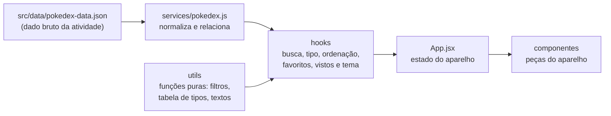
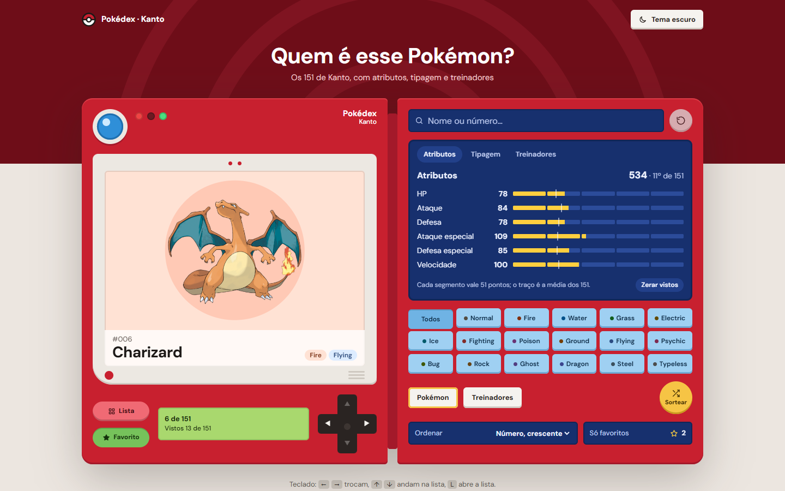
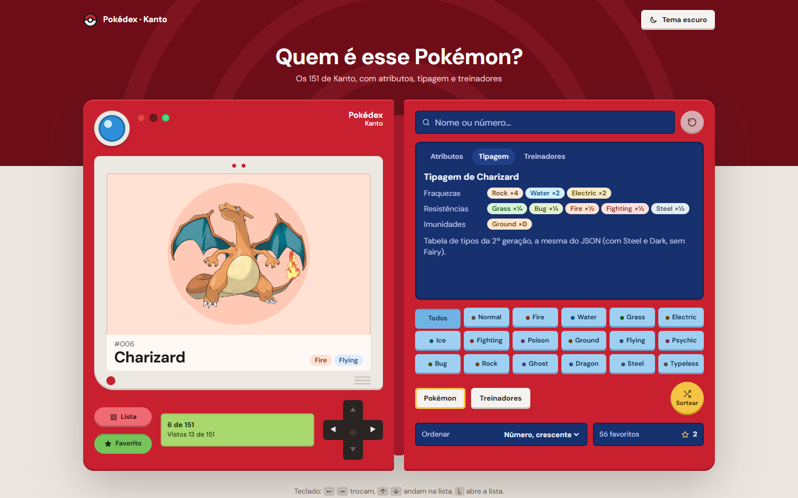
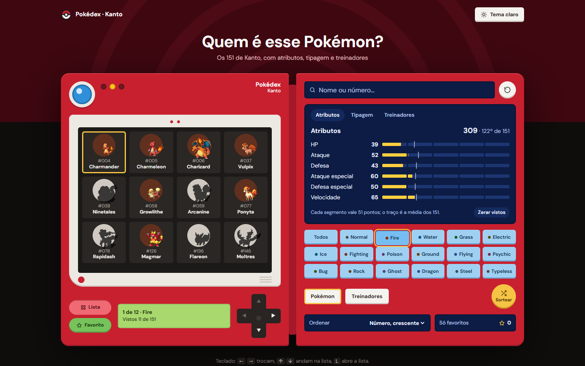
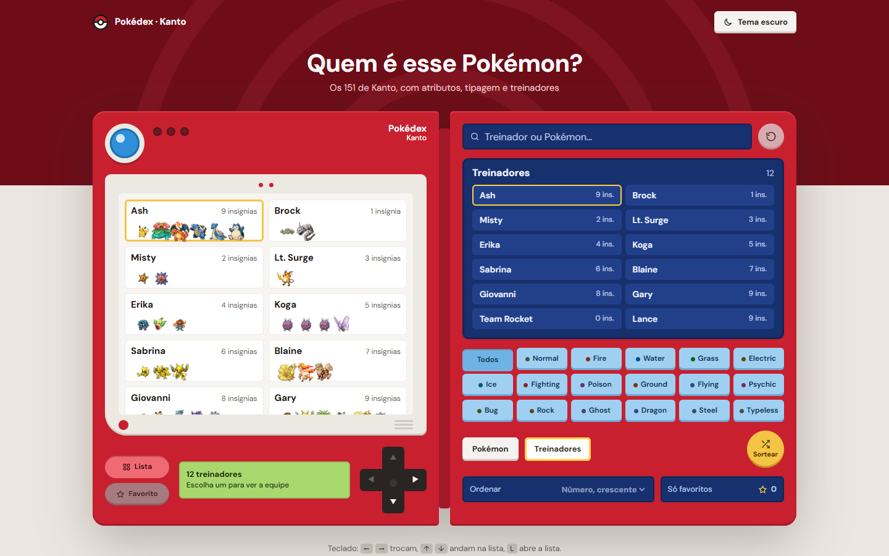
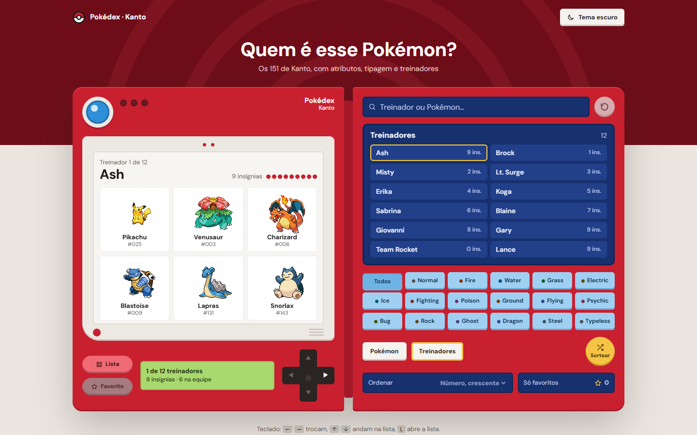
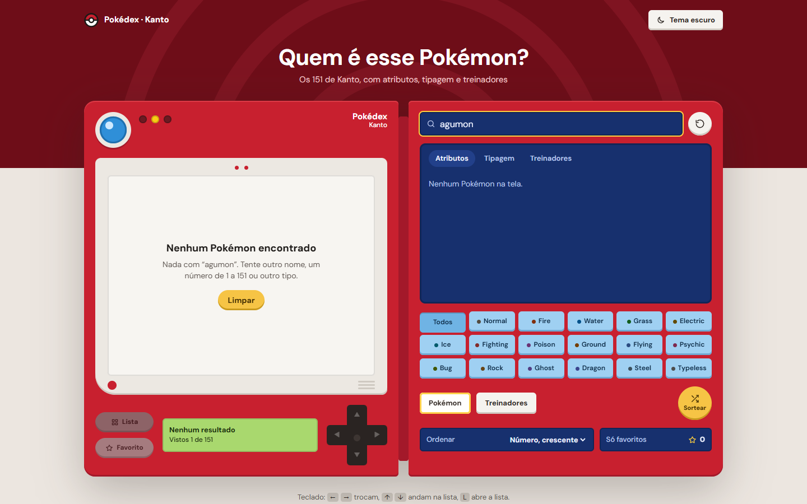
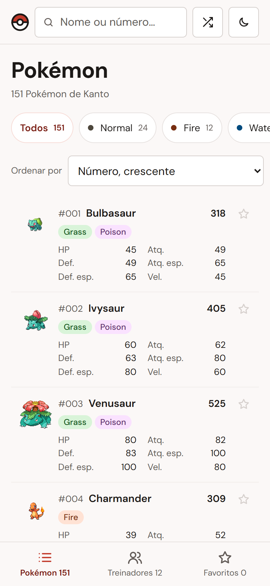

# Pokédex de Kanto

> [!NOTE]
> Pokédex interativa em **React + Vite**, desenhada como o próprio aparelho: o Pokémon aparece no visor da esquerda e o painel da direita traz busca, atributos, tipagem, filtro por tipo e treinadores. Todos os dados vêm do `pokedex-data.json` fornecido na atividade.

<table>
  <tr>
    <td width="800px">
      <div align="justify">
        Atividade 03 da disciplina <b>Desenvolvimento e Integração de Aplicações Web</b>, do Prof. Dr. João Paulo Aramuni, feita em dupla com <i>Pair Programming</i>. Em vez de uma lista de cartões, a interface é uma Pokédex vermelha aberta como um livro, e cada peça dela faz alguma coisa: o direcional troca de Pokémon, a lente acende a cada troca, as luzes mostram o estado, o LCD diz onde você está na lista e o teclado azul filtra por tipo.
      </div>
    </td>
    <td>
      <div>
        
      </div>
    </td>
  </tr>
</table>

---

## 🚧 Status do Projeto

    

---

## 📚 Índice

- [Sobre o Projeto](#-sobre-o-projeto)
- [Funcionalidades Principais](#-funcionalidades-principais)
- [Como usar o aparelho](#-como-usar-o-aparelho)
- [Tecnologias Utilizadas](#-tecnologias-utilizadas)
- [Arquitetura](#-arquitetura)
- [Instalação e Execução](#-instalação-e-execução)
- [Dados e Imagens](#-dados-e-imagens)
- [Estrutura de Pastas](#-estrutura-de-pastas)
- [Demonstração](#-demonstração)
- [Testes](#-testes)
- [Documentações utilizadas](#-documentações-utilizadas)
- [Autores](#-autores)
- [Agradecimentos](#-agradecimentos)

---

## 📝 Sobre o Projeto

O objetivo da atividade é praticar React: componentes, props, estado, eventos, renderização de listas, filtros e organização de um projeto front-end. A aplicação lê o `pokedex-data.json` da atividade e não depende de banco de dados nem de servidor próprio.

A identidade visual foi definida antes do código, no [`DESIGN.md`](DESIGN.md). O aparelho é uma interpretação própria da Pokédex vermelha, desenhada só com CSS, sem imagem do brinquedo. Também entram ideias de duas referências, redesenhadas no estilo do aparelho:

- **[gabrielayresdev/Pokedex](https://github.com/gabrielayresdev/Pokedex):** a faixa do topo com a pergunta "Quem é esse Pokémon?", o círculo na cor do tipo atrás da arte, as barras de atributo em segmentos e as fraquezas.
- **[Informações da Pokédex (psoul)](https://psoul.gg/wiki/guides/informacoes-da-pokedex/):** o registro de Pokémon vistos e as relações de tipagem (fraquezas, resistências e imunidades).

---

## ✨ Funcionalidades Principais

**Pedidas na atividade**

- 🐾 **Os 151 Pokémon** no visor, um de cada vez ou em grade de miniaturas, com número, nome, tipos, HP, Ataque, Defesa, Ataque especial, Defesa especial e Velocidade.
- 🔎 **Busca a cada tecla** por nome (`bulba`) ou número (`25`, `#25` ou `025`).
- 🧬 **Filtro por tipo** no teclado azul, com os tipos e as contagens tirados do JSON.
- 📄 **Detalhes** na tela azul: barras dos seis atributos, total e posição entre os 151.
- 🧑‍🚀 **Treinadores**: o modo Treinadores abre com os 12 no visor, cada um com insígnias e equipe em miniatura. Escolher um mostra a ficha com a equipe grande, e clicar num Pokémon da equipe abre esse Pokémon.
- ⚠️ **Lista vazia tratada**: o visor diz o que foi buscado e oferece "Limpar".
- 📱 **Layout responsivo**: aberto na horizontal no computador e na vertical no tablet e no celular.

**Desafios opcionais feitos**

- 📊 **Ordenação** por número, nome, total ou qualquer atributo.
- ⭐ **Favoritos**, salvos no navegador, com o filtro "Só favoritos".
- 🎲 **Pokémon aleatório**, sorteado entre os da lista atual.
- 🌙 **Tema escuro**, que segue o sistema e pode ser trocado no topo.
- 🌐 **API externa**: imagens da PokéAPI. Se elas não carregarem, aparecem as iniciais, e a Pokédex continua funcionando só com o JSON.

**Extras**

- 🛡️ **Tipagem**: fraquezas (×4 e ×2), resistências (×½ e ×¼) e imunidades (×0), calculadas pela tabela de tipos da 2ª geração, a mesma do JSON (com Steel e Dark, sem Fairy).
- 👁️ **Registro de vistos**: todo Pokémon aberto no visor fica registrado no navegador. Na grade, os não vistos aparecem em silhueta.
- 🏅 **Posição pelo total** ("534 · 11º de 151"), com empates dividindo a mesma posição, e a média dos 151 marcada em cada barra.
- 🔗 **Relação treinador e Pokémon** nos dois sentidos: a aba Treinadores do Pokémon leva ao treinador, e a equipe do treinador leva ao Pokémon.
- ⌨️ **Teclado**: `←` `→` trocam, `↑` `↓` andam na grade, `L` abre a lista e `Esc` fecha.

---

## 🕹 Como usar o aparelho

| Peça | O que faz |
| :--- | :--- |
| **Visor** (esquerda) | Mostra o Pokémon com a arte oficial sobre a cor do tipo. Com "Lista", vira uma grade de miniaturas dos resultados. No modo Treinadores, mostra os 12 treinadores ou a ficha de um deles |
| **Direcional** | ◀ ▶ anterior e próximo; ▲ ▼ sobem e descem na grade; o centro abre e fecha a lista |
| **Lente azul** | Acende a cada troca de Pokémon |
| **Luzes** | Vermelha: é favorito. Amarela: há busca ou filtro. Verde: a imagem carregou |
| **LCD verde** | Posição na lista ("4 de 12 · Fire") e quantos você já viu |
| **Lista** e **Favorito** | Abrem a grade no visor e marcam o Pokémon como favorito |
| **Visor de busca** | Busca por nome ou número; o botão ao lado limpa busca e filtro |
| **Tela azul** | Abas Atributos, Tipagem e Treinadores; no modo Treinadores, a lista dos 12 |
| **Teclado azul** | Filtro por tipo |
| **Botões brancos** | Modo Pokémon ou Treinadores |
| **Botão amarelo** | Sorteia um Pokémon |
| **Telas de baixo** | Ordenação e "Só favoritos" |

---

## 🛠 Tecnologias Utilizadas

### 💻 Front-end

- **Biblioteca:** React 19, com componentes funcionais e hooks
- **Linguagem:** JavaScript (ES2022+)
- **Build Tool:** Vite 8
- **Estilização:** CSS puro, um arquivo por componente em `src/css`, com variáveis de tema em `src/index.css`
- **Gerenciamento de estado:** `useState`, `useMemo`, `useEffect` e hooks próprios (`usePokedexFilters`, `useFavorites`, `useSeen`, `useTheme` e `useMediaQuery`)
- **Fonte:** DM Sans, empacotada pelo `@fontsource-variable/dm-sans`, sem CDN
- **Qualidade:** Vitest para os testes e oxlint (padrão do template do Vite) para o lint

Não há back-end nem banco de dados, porque a atividade fornece os dados em JSON.

---

## 🏗 Arquitetura

Os dados passam por três camadas, e cada uma tem uma responsabilidade só:



- **`services/pokedex.js`** lê o JSON uma vez e entrega os dados prontos para a tela: os tipos como lista de nomes, o total e a posição de cada Pokémon, os treinadores que têm cada um, as equipes resolvidas pelos `pokemonIds`, a contagem por tipo e a média de cada atributo. Nenhum componente lê o JSON direto.
- **`utils/`** guarda a lógica como funções puras: busca, filtro e ordenação (`filters.js`), a tabela de tipos (`typeChart.js`) e os textos do LCD (`describe.js`). Elas recebem dados e devolvem dados, sem alterar nada, e por isso são testadas sem abrir o navegador.
- **Hooks** guardam só o que a pessoa escolhe. A lista visível, o Pokémon no visor, as luzes e o texto do LCD são **estado derivado**, calculados a cada renderização, e nunca são guardados à parte. Se o Pokémon escolhido sai da lista por causa de um filtro, o visor mostra o primeiro resultado sem precisar de nenhum `useEffect`.
- **Componentes** são as peças do aparelho. Recebem dados por props e avisam eventos por callbacks. A grade do visor usa `memo` nas miniaturas.

**Decisões e limitações**

- **Sem roteador:** o modo (Pokémon ou Treinadores) e a aba são estados do `App`. A atividade não pede uma URL por tela, e uma dependência a menos mantém o projeto simples.
- **Tabela de tipos da 2ª geração:** é a que combina com o JSON, que tem Steel e Dark e não tem Fairy. O Mew vem com `types: []` e aparece como `Typeless`, sem relações.
- **Peculiaridades do JSON:** Koga tem três Venonat e Lance tem dois Dragonite; a equipe é mostrada como está no arquivo.
- **Teclado global:** as setas valem para o aparelho inteiro, exceto quando o foco está num campo ou nas abas da tela azul, que usam as próprias setas.

---

## 🔧 Instalação e Execução

### Pré-requisitos

- **Node.js** 20.19 ou superior (exigência do Vite 8)
- **npm**, que vem com o Node

Não há variáveis de ambiente: o projeto não usa chave nem serviço com login.

### 📦 Instalação de Dependências

```bash
npm install
```

### ▶️ Como Executar a Aplicação

```bash
npm run dev
```

Abra **http://127.0.0.1:5173** no navegador.

> [!TIP]
> O servidor fica fixo em `127.0.0.1:5173` (`vite.config.js`). No Windows, `localhost` às vezes faz o Vite escutar só em IPv6 ou trocar de porta sem avisar.

### Outros comandos

| Comando | O que faz |
| :--- | :--- |
| `npm test` | Roda os testes uma vez |
| `npm run test:watch` | Roda os testes a cada alteração |
| `npm run lint` | Confere o código com o oxlint |
| `npm run build` | Gera a versão de produção em `dist/` |
| `npm run preview` | Serve a pasta `dist/` para conferir o build |

---

## 🗂 Dados e Imagens

- **Dados:** `src/data/pokedex-data.json`, o arquivo da atividade sem edição: 151 Pokémon, 18 tipos e 12 treinadores.
- **Imagens:** [repositório de sprites da PokéAPI](https://github.com/PokeAPI/sprites), carregadas pelo endereço do arquivo:
  - miniaturas: `https://raw.githubusercontent.com/PokeAPI/sprites/master/sprites/pokemon/{id}.png`
  - visor: `https://raw.githubusercontent.com/PokeAPI/sprites/master/sprites/pokemon/other/official-artwork/{id}.png`
- Se a imagem falhar (sem internet, por exemplo), o Pokémon aparece com as iniciais no tom do tipo, e a luz verde fica apagada.
- **Favoritos, vistos e tema** ficam no `localStorage` do navegador.

> [!IMPORTANT]
> Pokémon e os nomes e imagens relacionados são marcas da Nintendo, da Game Freak e da Creatures. Este projeto é só acadêmico, sem fins comerciais.

---

## 📁 Estrutura de Pastas

```
.
├── public/
│   └── favicon.svg              # marca da Pokédex
├── docs/
│   └── prints/                  # imagens usadas neste README
├── src/
│   ├── components/              # peças do aparelho (um componente por arquivo)
│   │   ├── DeviceTop.jsx        # lente e luzes
│   │   ├── MainScreen.jsx       # moldura do visor
│   │   ├── PokemonCard.jsx      # um Pokémon no visor
│   │   ├── PokemonList.jsx      # grade de miniaturas no visor
│   │   ├── TrainerCard.jsx      # ficha de um treinador no visor
│   │   ├── TrainerGrid.jsx      # os 12 treinadores no visor
│   │   ├── EmptyState.jsx       # visor sem resultado
│   │   ├── StatusLcd.jsx        # LCD verde
│   │   ├── DPad.jsx             # direcional
│   │   ├── SearchBar.jsx        # visor de busca
│   │   ├── InfoScreen.jsx       # tela azul com abas
│   │   ├── PokemonDetails.jsx   # abas Atributos, Tipagem e Treinadores; lista de treinadores
│   │   ├── StatBar.jsx          # barra de atributo em 5 segmentos
│   │   ├── TypeFilter.jsx       # teclado azul de tipos
│   │   ├── PanelControls.jsx    # modos, sorteio, ordenação, favoritos e pílulas
│   │   └── ...                  # TypeBadge, PokemonImage, BrandMark, Icon
│   ├── constants/               # cores dos tipos e atributos
│   ├── css/                     # um arquivo CSS por componente
│   ├── data/
│   │   └── pokedex-data.json    # dados da atividade
│   ├── hooks/                   # usePokedexFilters, useFavorites, useSeen, useTheme, useMediaQuery
│   ├── services/
│   │   └── pokedex.js           # normaliza e relaciona os dados do JSON
│   ├── utils/                   # filtros, tabela de tipos, textos (com testes)
│   ├── App.jsx                  # estado do aparelho e composição das duas metades
│   ├── main.jsx                 # ponto de entrada
│   └── index.css                # variáveis de tema, tema escuro e base
├── DESIGN.md                    # direção visual: o aparelho, cores e interação
├── index.html
├── package.json
└── vite.config.js
```

---

## 🎥 Demonstração

### 🌐 Aplicação Web

**Visor**, com atributos em segmentos, total e posição:



**Tipagem**, com fraquezas, resistências e imunidades:



**Lista no visor**, filtrada por Fire, no tema escuro. Os não vistos aparecem em silhueta:



**Treinadores**: os 12 no visor, com insígnias e equipe:



**Ficha de um treinador**, com a equipe grande:



**Busca sem resultado:**



**Celular**, com o aparelho aberto na vertical:



---

## 🧪 Testes

```bash
npm test
```

São 42 testes com Vitest, cobrindo a lógica que decide o que aparece no aparelho:

- **Busca:** "Bulba" devolve só o Bulbasaur, como no enunciado. A busca também aceita número com ou sem `#` e com ou sem zeros à esquerda, ignora acentos e maiúsculas, e retorna uma lista vazia quando nada combina.
- **Filtro:** a contagem por tipo bate com o JSON (12 Fire, 33 Poison), e Pokémon de dois tipos entram nos dois. Busca e tipo funcionam juntos.
- **Ordenação:** por atributo (o Chansey lidera o HP, com 250), por total (Mewtwo, Dragonite, Mew), por nome e de volta pelo número.
- **Tipagem:** Charizard tem Rock ×4, Water e Electric ×2 e é imune a Ground. Gengar é imune a Normal e Fighting. Magnemite (Electric/Steel) tem Ground ×4 e é imune a Poison. Mew não tem relações.
- **Dados:** o total soma os seis atributos, o ranking dá a mesma posição a totais iguais, o Mew aparece como `Typeless`, as equipes mantêm os repetidos e cada Pokémon aponta para os treinadores que o têm.
- **LCD:** posição, busca, tipo e favoritos nos textos curtos.

Também foram conferidos no navegador (Edge), em 1440, 768 e 390 px de largura: setas, busca, filtro, lista no visor, abas, treinadores, favoritos, vistos, tema, estado vazio, movimento reduzido e foco pelo teclado. Nenhuma largura tem rolagem horizontal, todo texto medido tem contraste acima de 4,5:1 nos dois temas, e no celular todos os controles têm pelo menos 44px.

---

## 🔗 Documentações utilizadas

- [React](https://react.dev/)
- [Vite](https://vite.dev/)
- [Vitest](https://vitest.dev/)
- [MDN: ARIA tabs](https://developer.mozilla.org/pt-BR/docs/Web/Accessibility/ARIA/Roles/tab_role)
- [PokéAPI](https://pokeapi.co/docs/v2) e [repositório de sprites](https://github.com/PokeAPI/sprites)
- [Enunciado da Atividade 03](https://github.com/joaopauloaramuni/desenvolvimento-e-integracao-de-aplicacoes-web/blob/main/ATIVIDADES/ATIVIDADE%2003.md)

---

## 👥 Autores

| Nome | GitHub |
| :--- | :--- |
| Victor Cândido Leite | [@thevictorcandido](https://github.com/thevictorcandido) |
| Marcelo Gomes de Oliveira Junior | [@engsoftmarcelo](https://github.com/engsoftmarcelo) |

---

## 🙏 Agradecimentos

Ao Prof. Dr. [João Paulo Aramuni](https://github.com/joaopauloaramuni), pelo enunciado, pelos dados e pelo modelo de README. À [PokéAPI](https://pokeapi.co/), pelas imagens. A [gabrielayresdev/Pokedex](https://github.com/gabrielayresdev/Pokedex) e ao guia da [psoul](https://psoul.gg/wiki/guides/informacoes-da-pokedex/), pelas referências de visual e de funcionalidade.
